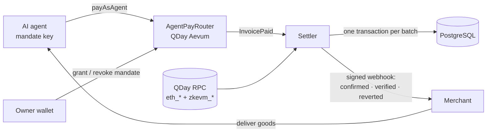

# Aevum Settle

**Payment confirmation infrastructure for AI agents paying in tUSD8 on QDay Aevum.**

An agent pays a merchant's invoice from its owner's wallet, under a mandate the owner can cap,
limit to certain merchants, let expire or revoke instantly. The merchant then needs to know when
that payment is *safe to act on*: not just "a transaction was sent", but "this payment is in a
canonical block, and has the assurance my policy requires for this amount". Aevum Settle answers
that question and tells the merchant through a signed webhook, exactly once, with a compensating
event if a payment it announced is ever reorged away.

> Status: in development for the Aevum Builder Challenge #1 (build window Nov 16 – Dec 11, 2026).

## Why this is different on QDay

QDay Aevum is a Polygon CDK zkEVM chain (validium). A payment passes through three levels of
assurance, which the settler tracks separately:

| Level | Meaning | Typical delay |
|---|---|---|
| `trusted` | in a block produced by the sequencer | ~1 s |
| `virtual` | its batch has been sequenced on L1 | ~10 min |
| `verified` | a validity proof of its batch has been verified on L1; final | ~80–90 min |

Waiting 90 minutes for a $0.05 API call is useless, and serving a $500 order on the sequencer's word
is reckless. So the merchant sets a **confirmation policy by amount**:

```
CONFIRM_POLICY=trusted<=1,virtual<=100,verified
```

Payments up to 1 tUSD8 are confirmed in about a second, up to 100 once on L1, anything larger once
proven. Payments confirmed early get a second `payment.verified` event when they become final, and
`/v1/evidence/{block}` returns the L1 sequence and verify transactions behind any block.

## Components

| Path | What |
|---|---|
| [`contracts/`](contracts) | `AgentPayRouter`: non-custodial invoice payments with per-agent mandates (per-payment cap, daily cap, expiry, merchant allowlist, instant revoke) and once-only invoices |
| [`settler/`](settler) | Go service: follows `InvoicePaid` events through trusted → virtual → verified, survives reorgs, RPC failures and restarts, delivers HMAC-signed webhooks from a transactional outbox, serves an HTTP API |



## Quick start

```bash
cp .env.example .env
docker compose up -d db

# contracts
cd contracts && npm ci && npx hardhat test

# settler
cd ../settler && go test ./...
```

## Prior work

The settler's reorg-safe indexing core (cursor + parent-hash checks, atomic batch writes, outbox,
range-limit learning, randomised reorg simulation) is adapted from the author's earlier open-source
project [base-usdc-indexer](https://github.com/BrianLiu0531/base-usdc-indexer), which watched USDC
transfers on Base. Everything QDay-specific was written during the build window: the
`AgentPayRouter` contract, zkEVM three-level assurance and L1 evidence, the per-amount confirmation
policy, the `payment.*` event model and the API.

## License

MIT
