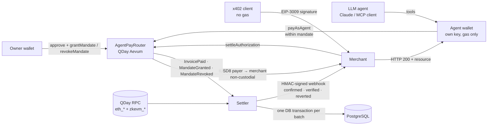

# Aevum Settle

**Payment confirmation infrastructure for AI agents paying in tUSD8 on QDay Aevum.**

An AI agent pays a merchant's invoice from its owner's wallet, under a **mandate** the owner can
cap, limit to certain merchants, let expire or revoke instantly. The merchant then has to decide
when that payment is *safe to act on*: not "a transaction was sent", but "this payment is in a
canonical block and has the assurance my policy requires for this amount". Aevum Settle answers
that question and tells the merchant through a signed webhook, exactly once per event, with a
compensating event if a payment it announced is ever reorged away.

It speaks **x402 v2**, so a merchant can take payment from a mandated agent and, through tUSD8's
native EIP-3009 support, from any standard x402 client without the payer spending gas. An LLM
agent (Claude, or anything that speaks MCP) gets the wallet as tools, and the on-chain mandate
bounds whatever the model decides to do.

> Built for the Aevum Builder Challenge #1 (build window Nov 16 – Dec 11, 2026).

| | |
|---|---|
| Chain | QDay Aevum testnet, chain ID `44005`, RPC `https://rpc-test.qday.info` |
| Token | tUSD8 [`0x456569838f1d43009A91ebA4263147Afd7233483`](https://explorer-test.qday.info/address/0x456569838f1d43009A91ebA4263147Afd7233483) (6 decimals, EIP-3009) |
| AgentPayRouter | _see [Testnet deployment](#testnet-deployment)_ |
| Explorer | https://explorer-test.qday.info |

## Contents

- [Why this matters on QDay](#why-this-matters-on-qday)
- [How it works](#how-it-works)
- [Run it locally in one command](#run-it-locally-in-one-command)
- [Run it on QDay testnet](#run-it-on-qday-testnet) · [Deploy a public demo](docs/DEPLOY.md)
- [AI agent: Claude and MCP](#ai-agent-claude-and-mcp)
- [x402 compatibility](#x402-compatibility)
- [The mandate: least privilege for agents](#the-mandate-least-privilege-for-agents)
- [Settler API](#settler-api) · [Webhooks](#webhooks) · [Agent SDK](#agent-sdk) · [Demo merchant](#demo-merchant)
- [Resilience and tests](#resilience-and-tests)
- [QDay platform notes](#qday-platform-notes)
- [Configuration](#configuration) · [Limitations and roadmap](#limitations-and-roadmap) · [Prior work](#prior-work)

## Why this matters on QDay

QDay Aevum is a Polygon CDK zkEVM chain (validium). A payment passes through three levels of
assurance, and the settler tracks each one separately (read live from `eth_*` and `zkevm_*` RPC):

| Level | Meaning | Typical delay | How the settler knows |
|---|---|---|---|
| `trusted` | in a block produced by the sequencer | ~1 s | `latest` block |
| `virtual` | its batch has been sequenced on L1 | ~10 min | `zkevm_virtualBatchNumber` → last block of that batch |
| `verified` | a validity proof of its batch is verified on L1; final | ~80–90 min | `finalized` tag (= last verified batch) |

Waiting 90 minutes to sell a $0.05 API call makes pay-per-call impossible; serving a $500 order on
the sequencer's word alone is reckless. So the merchant sets a **confirmation policy by amount**:

```
CONFIRM_POLICY=trusted<=1,virtual<=100,verified
```

Payments up to 1 tUSD8 are released in about a second, up to 100 once the batch is on L1, anything
larger once proven. A payment released early gets a second `payment.verified` event when it becomes
final, and `GET /v1/evidence/{block}` returns the zkEVM batch and the **L1 sequence and verify
transactions** behind any block: proof beyond the settler's word.

## How it works



One purchase, end to end:

```mermaid
sequenceDiagram
    participant Ag as Agent
    participant Me as Merchant
    participant Ro as AgentPayRouter
    participant Se as Settler
    Ag->>Me: GET /api/report
    Me-->>Ag: 402 + PAYMENT-REQUIRED {accepts: aevum-mandate, exact; 20 tUSD8}
    Ag->>Ag: check chain, router, own budget, mandate caps, allowlist, already paid?
    Ag->>Ro: payAsAgent(owner, keccak(INV-…), merchant, 20)
    Ro-->>Se: InvoicePaid (trusted, ~1 s)
    Ag->>Me: GET /api/report  PAYMENT-SIGNATURE {txHash}
    Me-->>Ag: 402 + PAYMENT-RESPONSE {settlement_pending: trusted, needs virtual}
    Note over Se: batch sequenced on L1 (virtual)
    Se->>Me: POST payment.confirmed (signed)
    Ag->>Me: GET /api/report  PAYMENT-SIGNATURE {txHash}
    Me-->>Ag: 200 + PAYMENT-RESPONSE {success} + resource + receipt
    Note over Se: proof verified on L1
    Se->>Me: POST payment.verified
```

| Path | What |
|---|---|
| [`contracts/`](contracts) | `AgentPayRouter.sol`: non-custodial invoice payments with per-agent mandates, once-only invoices, and `settleAuthorization` for x402 `exact` (EIP-3009). Hardhat, 20 tests |
| [`settler/`](settler) | Go service: follows `InvoicePaid` through trusted → virtual → verified and the mandate audit trail, survives reorgs, RPC failures and restarts, delivers signed webhooks from a transactional outbox, serves the API, a live dashboard (`/`) and the owner console (`/console`) |
| [`demo/sdk/`](demo/sdk) | Agent SDK: `AgentPayer` (mandate checks → pay → wait, x402-aware `fetch`), `ExactPayer` (standard x402 `exact` client), x402 helpers, webhook verifier, LLM tool layer |
| [`demo/ai-agent.js`](demo/ai-agent.js) | Claude as a purchasing agent (Messages API tool runner), with an optional human approval gate |
| [`demo/mcp.js`](demo/mcp.js) | MCP server: the agent wallet as tools for Claude Code, Claude Desktop or any MCP client |
| [`demo/agent.js`](demo/agent.js) | Agent CLI: `status`, `buy`, `wait`, `pay-exact`, `scenarios`, and owner commands `approve`, `grant`, `revoke`, `fund-agent` |
| [`demo/merchant.js`](demo/merchant.js) | Demo merchant: x402 v2 paid API, releases resources only on the settler's word, withdraws them on `payment.reverted`, refunds under- and overpayments, SQLite records |
| [`scripts/local-demo.sh`](scripts/local-demo.sh) | The whole stack on a local chain: 12 scenarios plus the MCP server (also run in CI) |
| [`render.yaml`](render.yaml) · [`docs/DEPLOY.md`](docs/DEPLOY.md) | One-click public deployment |

## Run it locally in one command

Needs Docker, Node 22.13+, Go 1.26.

```bash
cd contracts && npm ci && cd ../demo && npm ci && cd ..
scripts/local-demo.sh          # add --keep to leave everything running
```

It starts Postgres, a Hardhat node mining one block per second, deploys a mock tUSD8 (with the
same EIP-3009 interface as the real one) and the router, funds the owner, grants the agent a
mandate (150 per payment, 200 per day, 7 days, demo merchant only), and runs the settler with
`virtual` at 10 blocks deep and `verified` at 30 to mimic QDay's tiers. Then:

```
1. Pay-per-call: 0.05 tUSD8 quote (policy: trusted, ~1 s)
  ✓ 200 after 2.3s (released at trusted assurance)
2. 20 tUSD8 report (policy: virtual, batch must be on L1)
  · waiting: payment is trusted, merchant needs virtual
  ✓ 200 after 10.3s (released at virtual assurance)
3. 120 tUSD8 archive (policy: verified, validity proof on L1)
  · waiting: payment is virtual, merchant needs verified
  ✓ 200 after 32.6s (released at verified assurance)
4. 500 tUSD8 licence: over the per-payment cap, refused before signing
  ✓ refused OVER_PER_PAYMENT_CAP: 500.0 tUSD8 is above the per-payment cap of 150.0
5. Same, with the agent's checks bypassed: the contract itself refuses
  ✓ refused OVER_PER_PAYMENT_CAP: contract refused: OverPerPaymentCap(500000000, 150000000)
6. Another 120 tUSD8 archive: over what is left of the daily cap
  ✓ refused OVER_DAILY_CAP: 120.0 tUSD8 is above what is left of today's cap (59.95)
7. Paying invoice #1 again (a retrying agent): the contract refuses a double payment
  ✓ refused ALREADY_PAID: contract refused: InvoiceAlreadyPaid(0x2958…)
8. An invoice from a merchant outside the allowlist
  ✓ refused MERCHANT_NOT_ALLOWED: contract refused: MerchantNotAllowed()
9. The owner revokes the mandate; the agent can no longer pay
  ✓ refused NO_MANDATE: contract refused: NoMandate()
10. Standard x402 "exact": the owner pays from their own wallet by signing an EIP-3009 authorization (no gas, no allowance)
  ✓ 200 after 2.2s (scheme exact, settled by the merchant in 0x0f0b…)
11. A payment below the price: the merchant does not deliver, and refunds it once the settler confirms it
  ✓ refunded: 0.04 tUSD8 back to the payer: 0x61a9…
12. Local only: a reorg removes a delivered payment; the merchant is told and withdraws access
  ✓ payment.reverted delivered; merchant now answers 202 for INV-6beb…

all 12 scenarios behaved as expected

› MCP server (the wallet tools an LLM agent gets), driven by a real MCP client
tools: wallet_status, list_products, buy, check_purchase
buy({"product":"quote"}) -> {"status":"delivered", …}
buy({"product":"report","max_price":5}) -> {"status":"refused","code":"OVER_TASK_BUDGET", …}
buy({"product":"bulk"}) -> {"status":"refused","code":"OVER_PER_PAYMENT_CAP", …}
MCP smoke test passed
```

With `--keep`: dashboard http://localhost:8080, owner console http://localhost:8080/console,
merchant http://localhost:8787. Try the Claude agent against it:
`cd demo && ENV_FILE=../.env.local MERCHANT_URL=http://localhost:8787 node ai-agent.js`.

## Run it on QDay testnet

1. **Wallets.** `cp .env.example .env` and fill in fresh testnet keys: `DEPLOYER_PRIVATE_KEY` /
   `OWNER_PRIVATE_KEY` (same key is fine), `AGENT_PRIVATE_KEY`, `MERCHANT_ADDRESS` (and
   `MERCHANT_PRIVATE_KEY` to enable x402 `exact` and refunds), and a random `WEBHOOK_SECRET` (16+
   characters). Claim tQDAY and tUSD8 for the owner at https://faucet.qday.info.
2. **Deploy** (writes `ROUTER_ADDRESS` and `START_BLOCK` into `.env`):
   ```bash
   cd contracts && npm ci && npm run deploy
   ```
3. **Set up the agent** (or do approve and grant in the owner console at `/console` with a browser wallet):
   ```bash
   cd ../demo && npm ci
   node agent.js owner fund-agent 0.05     # gas for the agent's own key
   node agent.js owner approve 300         # router may move up to 300 tUSD8 in total
   node agent.js owner grant --per 150 --daily 200 --days 7 --merchant $MERCHANT_ADDRESS
   node agent.js status
   ```
   If the merchant settles x402 `exact` payments or sends refunds, give it gas too: send a little
   tQDAY to `MERCHANT_ADDRESS` from any funded wallet.
4. **Start the settler and the merchant:**
   ```bash
   cd .. && docker compose --profile demo up -d --build
   ```
   Dashboard http://localhost:8080, merchant http://localhost:8787. For a public URL see
   [docs/DEPLOY.md](docs/DEPLOY.md).
5. **Let the agent shop:**
   ```bash
   cd demo && MERCHANT_URL=http://localhost:8787 node agent.js scenarios   # scripted
   node ai-agent.js                                                          # Claude decides
   ```
   On QDay the 20 tUSD8 purchase takes ~10 minutes (virtual) and the 120 tUSD8 one ~90 minutes
   (verified); the CLI prints a `node agent.js wait …` command to resume. Granting the mandate again
   resets today's spend, so the scenarios can be re-run on the same day.

### Testnet deployment

| | Address / transaction |
|---|---|
| AgentPayRouter | _pending faucet funds_ |
| Deploy transaction | _pending_ |
| Mandate grant / revoke | _pending_ |
| Agent payments (trusted / virtual / verified) | _pending_ |
| x402 exact payment, refund | _pending_ |

## AI agent: Claude and MCP

The wallet is exposed to a model as four tools ([`demo/sdk/tools.js`](demo/sdk/tools.js)):

| Tool | Does |
|---|---|
| `wallet_status` | mandate (caps, what is left today, expiry) and the owner's balance |
| `list_products` | the merchant's catalog, prices, and how final each payment must be |
| `buy` | pays one product under the mandate; returns `delivered` (data + on-chain receipt), `pending`, or `refused` with a code |
| `check_purchase` | collects a pending purchase without paying again |

**Claude as the agent** ([`demo/ai-agent.js`](demo/ai-agent.js), Messages API tool runner on
`claude-opus-5-5`): give it a task and a budget; it reads its mandate, plans, buys, and adapts to
refusals (over the daily cap → buys something cheaper or explains what the owner must change).
`AGENT_CONFIRM_ABOVE=10` adds a human approval prompt for any purchase above 10 tUSD8. Needs Claude
API credentials (`ANTHROPIC_API_KEY`, or `ant auth login`).

```bash
cd demo && node ai-agent.js "Get the market quote and the PQ readiness report, within 25 tUSD8"
```

**Any MCP client** ([`demo/mcp.js`](demo/mcp.js)): the same tools over stdio.

```bash
claude mcp add aevum-wallet -- node /absolute/path/to/aevum-settle/demo/mcp.js
```

Then ask Claude Code "what can my agent wallet buy today?" or "buy the market quote". The server
reads `.env` like the CLI.

Why the model cannot overspend, whatever it is told (including by a prompt-injected API response):
the tools only buy from the one configured merchant, accept no URLs or addresses, can be capped
per call (`max_price`) and per agent (`AGENT_MAX_PRICE`), check the on-chain mandate before
signing, and the router enforces the mandate again.

## x402 compatibility

The merchant implements the [x402 v2](https://github.com/x402-foundation/x402) HTTP transport:
`402` with a base64 `PAYMENT-REQUIRED` header, the client's `PAYMENT-SIGNATURE`, and
`PAYMENT-RESPONSE` on the answer (network `eip155:44005`, asset tUSD8). Each invoice offers two
`accepts[]` entries:

| Scheme | Payer | Flow | Gas |
|---|---|---|---|
| `exact` (standard) | anyone with tUSD8 | signs an EIP-3009 `TransferWithAuthorization` to the merchant; the merchant settles it with `AgentPayRouter.settleAuthorization`, which records the invoice and moves the funds payer → merchant | merchant |
| `aevum-mandate` | an AI agent | pays on chain with `payAsAgent` under its owner's mandate, then sends the transaction hash | agent |

tUSD8 on QDay is a USDC-style FiatToken v2 (`version()` = 2, EIP-712 domain `tUSD8`/`2`,
`transferWithAuthorization`, `receiveWithAuthorization`, `permit`), checked on chain, so standard
x402 `exact` clients work as they do with USDC. Only the payee can submit an authorization to
`settleAuthorization`, so nobody can attach a signed authorization to a different invoice, and
since the payer's signature names the payee, a front-runner cannot redirect the funds.

Until the payment has the assurance the policy needs, the merchant answers `402` with
`PAYMENT-RESPONSE {"success": false, "errorReason": "settlement_pending", "transaction": "0x…"}`;
the client resends the same `PAYMENT-SIGNATURE` (idempotent) until it gets `200`.

## The mandate: least privilege for agents

The owner never hands the agent their key or their funds. The agent has its own key, which pays
only gas, and a mandate stored in the router:

| Control | Where enforced | Effect |
|---|---|---|
| Per-payment cap | contract (`OverPerPaymentCap`) | one bad invoice cannot drain the wallet |
| Daily cap | contract (`OverDailyCap`, resets each UTC day) | a leaked or prompt-injected key loses at most this per day |
| Expiry | contract (`MandateExpired`) | mandates die on their own |
| Merchant allowlist | contract (`MerchantNotAllowed`), scoped per grant | the agent can pay only merchants the owner chose |
| Instant revoke | contract (`NoMandate`) | one transaction; the allowlist is invalidated with it |
| Once-only invoices | contract (`InvoiceAlreadyPaid`) | a retrying or replayed agent cannot pay twice |
| Router allowance | ERC-20 | hard ceiling across all agents |
| Agent's own budget | SDK (`AGENT_MAX_PRICE`), tools (`max_price`) | the agent and the model can be stricter than the mandate |
| Human approval | `ai-agent.js` (`AGENT_CONFIRM_ABOVE`) | large purchases wait for a person |
| Pre-flight checks | SDK | chain, router, invoice expiry, caps, allowlist and paid status are checked and the transaction simulated before signing, so refusals cost no gas and come back as codes |

Funds move in one hop, payer → merchant; the router never holds a balance. **Audit trail:** the
settler indexes every `MandateGranted` and `MandateRevoked` (reorg-safe, like payments) and serves
the current state of each owner/agent pair with what it has spent at `GET /v1/mandates`; the
dashboard shows it as a table and a timeline.

## Settler API

Read-only JSON, CORS-enabled. Amounts come as `{"raw": "<base units>", "display": "<tUSD8>"}`.

| Endpoint | Answers |
|---|---|
| `GET /v1/status` | chain heights at each assurance level, indexer position, policy, totals |
| `GET /v1/payments?merchant=0x…&limit=25&before=<block>:<logIndex>` | payments newest first, with assurance, required level, confirmed |
| `GET /v1/invoices/{merchant}/{invoice}` | "is this invoice paid, and safe to deliver?" (`invoice` = `INV-…` label or 32-byte hex id) |
| `GET /v1/mandates?owner=0x…&agent=0x…` | each agent's current mandate (active / expired / revoked), grants, payments and spend, plus the event history |
| `GET /v1/evidence/{block}` | the zkEVM batch and its L1 sequence and verify transactions |
| `GET /v1/events?limit=30` | webhook delivery log: delivered, attempts, last error |
| `GET /metrics` · `GET /healthz` | Prometheus metrics · liveness |
| `GET /` · `GET /console` | live dashboard · owner console (browser wallet) |

```bash
$ curl -s localhost:8080/v1/invoices/0x7099…79C8/INV-bdf84730f2d5
{
  "merchant": "0x70997970c51812dc3a010c7d01b50e0d17dc79c8",
  "invoiceId": "0x541ea97b…28fb",
  "paid": true,
  "payment": {
    "amount": { "raw": "20000000", "display": "20" },
    "agent": "0x3c44cdddb6a900fa2b585dd299e03d12fa4293bc",
    "payer": "0xf39fd6e51aad88f6f4ce6ab8827279cfffb92266",
    "assurance": "virtual", "required": "virtual", "confirmed": true,
    "txHash": "0xcb79…569b", "blockNumber": 71,
    "explorerUrl": "https://explorer-test.qday.info/tx/0xcb79…569b"
  }
}

$ curl -s localhost:8080/v1/mandates
{ "agents": [{ "agent": "0x3c44…", "owner": "0xf39f…", "status": "active", "grants": 2,
               "payments": 4, "spent": { "raw": "140100000", "display": "140.1" },
               "current": { "kind": "granted", "perPaymentCap": { "display": "150" }, … } }],
  "events": [{ "kind": "granted", … }, { "kind": "revoked", … }, { "kind": "granted", … }] }

$ curl -s localhost:8080/v1/evidence/1234567
{ "block": 1234567, "batch": 50211, "l1SequenceTx": "0x…", "l1VerifyTx": "0x…" }
```

## Webhooks

`POST $WEBHOOK_URL` with `{"events": [...]}`, signed:

```
X-Settle-Timestamp: 1800000000
X-Settle-Signature: sha256=hex(HMAC-SHA256(WEBHOOK_SECRET, timestamp + "." + raw body))
```

| Event | When |
|---|---|
| `payment.confirmed` | the payment reached the level the policy requires for its amount: deliver |
| `payment.verified` | a payment confirmed before `verified` is now final |
| `payment.reverted` | a payment announced as confirmed was reorged away: withdraw or flag |

Each event carries `eventId` (stable; dedupe on it, delivery is at least once), `type`,
`invoiceId`, `merchant`, `payer`, `agent`, `amount` (base units), `txHash`, `logIndex`,
`blockNumber`, `blockHash`, `blockTime`, `assurance`, `required` and `explorerUrl`. Non-2xx answers
are retried. Events are written in the same database transaction as the payments they describe,
so none is lost or invented by a crash.

```js
import { verifyWebhook } from "./demo/sdk/index.js";
const events = verifyWebhook({ secret, timestamp: req.headers["x-settle-timestamp"],
  signature: req.headers["x-settle-signature"], body: rawBody }); // throws on forgery or replay (>5 min)
```

The Go sender and the JS verifier are pinned to the same test vector, so they cannot drift.

## Agent SDK

```js
import { Wallet, JsonRpcProvider } from "ethers";
import { AgentPayer, ExactPayer, PaymentRefused } from "./demo/sdk/index.js";
const provider = new JsonRpcProvider("https://rpc-test.qday.info");

// An AI agent under a mandate (x402 scheme aevum-mandate)
const agent = new AgentPayer({
  wallet: new Wallet(process.env.AGENT_PRIVATE_KEY, provider),
  owner: process.env.OWNER_ADDRESS, router: process.env.ROUTER_ADDRESS, chainId: 44005,
  maxPrice: "25", // the agent's own ceiling, below the mandate
});
try {
  const { response, paid } = await agent.fetch("https://merchant.example/api/report");
  console.log(response.status, paid?.txHash);         // 200 once the merchant's policy is met
} catch (e) {
  if (e instanceof PaymentRefused) console.log(e.code); // OVER_DAILY_CAP, MERCHANT_NOT_ALLOWED, …
}

// A person or self-funded agent: standard x402 exact, signs EIP-3009, pays no gas
const me = new ExactPayer({ signer: new Wallet(process.env.OWNER_PRIVATE_KEY), chainId: 44005 });
await me.fetch("https://merchant.example/api/quote");
```

Refusal codes: `WRONG_CHAIN`, `WRONG_ROUTER`, `INVALID_INVOICE`, `INVOICE_EXPIRED`,
`OVER_AGENT_BUDGET`, `ALREADY_PAID`, `NO_MANDATE`, `MANDATE_EXPIRED`, `MERCHANT_NOT_ALLOWED`,
`OVER_PER_PAYMENT_CAP`, `OVER_DAILY_CAP`, `NO_ACCEPTABLE_SCHEME`; contract reverts are decoded into
the same codes.

## Demo merchant

[`demo/merchant.js`](demo/merchant.js) is a reference for the receiving side:

- issues x402 invoices and keeps them in SQLite (`MERCHANT_DB`), so a restart loses nothing and a
  webhook event is never handled twice;
- releases a resource only when the settler confirms the payment at its required level (webhook,
  or the invoice API when polled), and withdraws access on `payment.reverted`;
- **refunds** automatically, and only once a payment is confirmed: the full amount if it is below
  the price or arrived after the invoice expired, the excess if it is above
  (`AUTO_REFUND=false` to do it by hand: `POST /api/invoices/{id}/refund` with
  `Authorization: Bearer $MERCHANT_ADMIN_TOKEN`);
- shows invoices, schemes, refunds and the webhook log at `/`.

## Resilience and tests

The settler keeps a cursor with parent-hash checks and writes each batch of blocks, payments,
mandate events and outbox events in one transaction under an advisory lock. On a hash mismatch it
rewinds, moves the payments to `orphaned_payments`, deletes orphaned mandate events, emits
`payment.reverted` for any payment that was confirmed, and never rewinds below the verified block.
RPC calls retry with backoff and fail over across `RPC_URLS`; `eth_getLogs` ranges shrink
automatically when a node rejects them (QDay allows 1000 blocks).

| Suite | Covers |
|---|---|
| `contracts`: `npx hardhat test` (20) | caps, daily reset, expiry, allowlist scoping across re-grants, revoke, once-only invoices, direct pay, events; `settleAuthorization`: payee-only, once-only, expired, zero |
| `settler`: `go test -race ./...` | tiered confirmation, merchant filter, reorgs (also during a fetch and with no new blocks), concurrent indexers, lagging nodes, range limits, refusal to rewind verified data, mandate audit trail through a reorg, event decoding, webhook signing, policy parsing |
| `settler`: `SOAK_SEEDS=100 go test -run Randomised ./internal/indexer` | randomised chains with reorgs and faults under 5 policies: every confirmed payment is canonical, every orphaned confirmed payment is reverted exactly once |
| `demo`: `npm test` (9) | webhook verification (shared vector with Go), x402 headers and `exact` signing/verification with tampering, policy mirror, invoice ids, revert decoding |
| `scripts/local-demo.sh` | the 12 scenarios above against a real node, settler, merchant and agent, reorg and refund included, then the MCP server through a real MCP client |

All run in [CI](.github/workflows/ci.yml).

## QDay platform notes

What we verified against the live testnet, for other builders:

- **Finality** comes in three steps (see above); `safe` equals `finalized`, and the virtual height
  is only available through `zkevm_virtualBatchNumber` and `zkevm_getBatchByNumber`, whose batch
  objects also carry the L1 `sendSequencesTxHash` and `verifyBatchTxHash`.
- **tUSD8 is a FiatToken v2** behind a proxy: EIP-3009 and EIP-2612 work, so gasless payments need
  no extra contracts.
- **EVM version is Shanghai**: no `MCOPY` or transient storage. OpenZeppelin 5.6's `EIP712` (via
  `ShortStrings`/`Bytes`) does not compile for it, so this repo targets `paris` and computes
  EIP-712 by hand where needed.
- **`eth_getLogs`** is limited to 1000 blocks per call.
- **ERC-4337**: EntryPoint v0.7 (`0x0000000071727De22E5E9d8BAf0edAc6f37da032`) is deployed and
  `https://bundler.qday.info` answers `eth_supportedEntryPoints` with it.

## Configuration

Everything is environment variables; [`.env.example`](.env.example) lists each one with its
default. The essentials: `ROUTER_ADDRESS`, `START_BLOCK`, `CONFIRM_POLICY`, `WEBHOOK_URL` and
`WEBHOOK_SECRET` for the settler; `MERCHANT_ADDRESS`, `MERCHANT_PRIVATE_KEY` and the same
`WEBHOOK_SECRET` for the merchant; `AGENT_PRIVATE_KEY` and `OWNER_ADDRESS` for the agent.

## Limitations and roadmap

- **Mandates are per owner address.** The router accepts any `msg.sender`, so ERC-4337 smart
  accounts already work as owners or agents; next is a session-key validator so the mandate lives
  in the owner's smart account and agent userOps go through QDay's bundler with a tUSD8 paymaster
  (no tQDAY for the agent).
- **Agent identity** is an address. Binding it to an ERC-8004-style identity or reputation registry
  would let merchants price by trust.
- **Post-quantum signatures**: the router only checks `msg.sender`, so a post-quantum account
  (e.g. hash-based signatures validated in a smart account) can be an owner or agent without any
  change here.
- **One token per router** (tUSD8).
- **Front-run `exact` authorizations**: if someone submits a payer's authorization straight to the
  token before the merchant does, the funds still reach the merchant but no `InvoicePaid` is
  emitted; the merchant's settlement then fails and the invoice must be reconciled by hand.

## Prior work

The settler's reorg-safe indexing core (cursor + parent-hash checks, atomic batch writes, outbox,
range-limit learning, randomised reorg simulation) is adapted from the author's earlier open-source
project [base-usdc-indexer](https://github.com/BrianLiu0531/base-usdc-indexer), which watched USDC
transfers on Base. Everything QDay-specific was written during the build window: the
`AgentPayRouter` contract, zkEVM three-level assurance and L1 evidence, the per-amount confirmation
policy, the `payment.*` event model, the mandate audit trail, the API, dashboard and owner console,
x402 support, the agent SDK, CLI, MCP server and Claude agent, and the demo merchant.

## License

[MIT](LICENSE)
