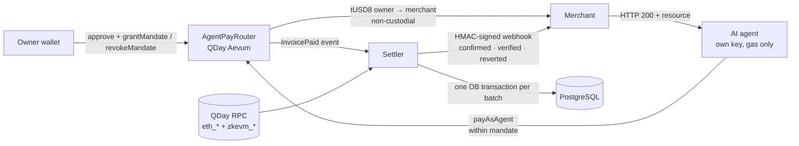
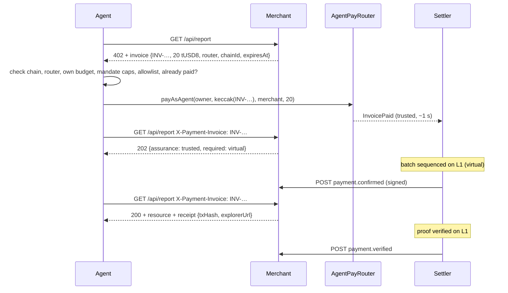

# Aevum Settle

**Payment confirmation infrastructure for AI agents paying in tUSD8 on QDay Aevum.**

An AI agent pays a merchant's invoice from its owner's wallet, under a **mandate** the owner can
cap, limit to certain merchants, let expire or revoke instantly. The merchant then has to decide
when that payment is *safe to act on*: not "a transaction was sent", but "this payment is in a
canonical block and has the assurance my policy requires for this amount". Aevum Settle answers
that question and tells the merchant through a signed webhook, exactly once per event, with a
compensating event if a payment it announced is ever reorged away.

> Built for the Aevum Builder Challenge #1 (build window Nov 16 – Dec 11, 2026).

| | |
|---|---|
| Chain | QDay Aevum testnet, chain ID `44005`, RPC `https://rpc-test.qday.info` |
| Token | tUSD8 [`0x456569838f1d43009A91ebA4263147Afd7233483`](https://explorer-test.qday.info/address/0x456569838f1d43009A91ebA4263147Afd7233483) (6 decimals) |
| AgentPayRouter | _see [Testnet deployment](#testnet-deployment)_ |
| Explorer | https://explorer-test.qday.info |

## Contents

- [Why this matters on QDay](#why-this-matters-on-qday)
- [How it works](#how-it-works)
- [Run it locally in one command](#run-it-locally-in-one-command)
- [Run it on QDay testnet](#run-it-on-qday-testnet)
- [The mandate: least privilege for agents](#the-mandate-least-privilege-for-agents)
- [Settler API](#settler-api) · [Webhooks](#webhooks) · [Agent SDK](#agent-sdk)
- [Resilience and tests](#resilience-and-tests)
- [Configuration](#configuration)
- [Limitations and roadmap](#limitations-and-roadmap) · [Prior work](#prior-work)

## Why this matters on QDay

QDay Aevum is a Polygon CDK zkEVM chain (validium). A payment passes through three levels of
assurance, and the settler tracks each one separately (read live from `eth_*` and `zkevm_*` RPC):

| Level | Meaning | Typical delay | How the settler knows |
|---|---|---|---|
| `trusted` | in a block produced by the sequencer | ~1 s | `latest` block |
| `virtual` | its batch has been sequenced on L1 | ~10 min | `zkevm_virtualBatchNumber` → last block of that batch |
| `verified` | a validity proof of its batch is verified on L1; final | ~80–90 min | `finalized` tag (= last verified batch) |

Waiting 90 minutes to sell a $0.05 API call makes pay-per-call impossible; serving a $500 order on
the sequencer's word alone is reckless. So the merchant sets a **confirmation policy by amount**:

```
CONFIRM_POLICY=trusted<=1,virtual<=100,verified
```

Payments up to 1 tUSD8 are released in about a second, up to 100 once the batch is on L1, anything
larger once proven. A payment released early gets a second `payment.verified` event when it becomes
final, and `GET /v1/evidence/{block}` returns the zkEVM batch and the **L1 sequence and verify
transactions** behind any block: proof beyond the settler's word.

## How it works



One purchase, end to end:



| Path | What |
|---|---|
| [`contracts/`](contracts) | `AgentPayRouter.sol`: non-custodial invoice payments with per-agent mandates and once-only invoices. Hardhat, 16 tests |
| [`settler/`](settler) | Go service: follows `InvoicePaid` through trusted → virtual → verified, survives reorgs, RPC failures and restarts, delivers signed webhooks from a transactional outbox, serves the API, a live dashboard (`/`) and the owner console (`/console`) |
| [`demo/sdk/`](demo/sdk) | Agent SDK (`AgentPayer`: check → pay → wait, 402-aware `fetch`) and the webhook verifier for merchants |
| [`demo/agent.js`](demo/agent.js) | Agent CLI: `status`, `buy`, `scenarios`, and owner commands `approve`, `grant`, `revoke`, `fund-agent` |
| [`demo/merchant.js`](demo/merchant.js) | Demo merchant: a paid API answering HTTP 402, releasing resources only on the settler's word, withdrawing them on `payment.reverted` |
| [`scripts/local-demo.sh`](scripts/local-demo.sh) | The whole stack on a local chain, scenarios included (also run in CI) |

## Run it locally in one command

Needs Docker, Node 20+, Go 1.26.

```bash
cd contracts && npm ci && cd ../demo && npm ci && cd ..
scripts/local-demo.sh          # add --keep to leave everything running
```

It starts Postgres, a Hardhat node mining one block per second, deploys a mock tUSD8 and the
router, funds the owner, grants the agent a mandate (150 per payment, 200 per day, 7 days, demo
merchant only), and runs the settler with `virtual` at 10 blocks deep and `verified` at 30 to
mimic QDay's tiers. Then the agent runs every scenario:

```
1. Pay-per-call: 0.05 tUSD8 quote (policy: trusted, ~1 s)
  ✓ 200 after 2.4s (released at trusted assurance)
2. 20 tUSD8 report (policy: virtual, batch must be on L1)
  · waiting: payment is trusted, merchant needs virtual
  ✓ 200 after 10.4s (released at virtual assurance)
3. 120 tUSD8 archive (policy: verified, validity proof on L1)
  · waiting: payment is virtual, merchant needs verified
  ✓ 200 after 30.6s (released at verified assurance)
4. 500 tUSD8 licence: over the per-payment cap, refused before signing
  ✓ refused OVER_PER_PAYMENT_CAP: 500.0 tUSD8 is above the per-payment cap of 150.0
5. Same, with the agent's checks bypassed: the contract itself refuses
  ✓ refused OVER_PER_PAYMENT_CAP: contract refused: OverPerPaymentCap(500000000, 150000000)
6. Another 120 tUSD8 archive: over what is left of the daily cap
  ✓ refused OVER_DAILY_CAP: 120.0 tUSD8 is above what is left of today's cap (59.95)
7. Paying invoice #1 again (a retrying agent): the contract refuses a double payment
  ✓ refused ALREADY_PAID: contract refused: InvoiceAlreadyPaid(0x5df8…)
8. An invoice from a merchant outside the allowlist
  ✓ refused MERCHANT_NOT_ALLOWED: contract refused: MerchantNotAllowed()
9. The owner revokes the mandate; the agent can no longer pay
  ✓ refused NO_MANDATE: contract refused: NoMandate()
10. Local only: a reorg removes a delivered payment; the merchant is told and withdraws access
  ✓ payment.reverted delivered; merchant now answers 202 for INV-fd74…

all 10 scenarios behaved as expected
```

With `--keep`: dashboard http://localhost:8080, owner console http://localhost:8080/console,
merchant http://localhost:8787.

## Run it on QDay testnet

1. **Wallets.** `cp .env.example .env` and fill in fresh testnet keys: `DEPLOYER_PRIVATE_KEY` /
   `OWNER_PRIVATE_KEY` (same key is fine), `AGENT_PRIVATE_KEY`, `MERCHANT_ADDRESS`, and a random
   `WEBHOOK_SECRET` (16+ characters). Claim tQDAY and tUSD8 for the owner at
   https://faucet.qday.info.
2. **Deploy** (writes `ROUTER_ADDRESS` and `START_BLOCK` into `.env`):
   ```bash
   cd contracts && npm ci && npm run deploy
   ```
3. **Set up the agent** (or do steps 3a–3b in the owner console at `/console` with a browser wallet):
   ```bash
   cd ../demo && npm ci
   node agent.js owner fund-agent 0.05     # gas for the agent's own key
   node agent.js owner approve 300         # router may move up to 300 tUSD8 in total
   node agent.js owner grant --per 150 --daily 200 --days 7 --merchant $MERCHANT_ADDRESS
   node agent.js status
   ```
4. **Start the settler and the merchant:**
   ```bash
   cd .. && docker compose --profile demo up -d --build
   ```
   Dashboard http://localhost:8080, merchant http://localhost:8787.
5. **Let the agent shop:**
   ```bash
   cd demo && MERCHANT_URL=http://localhost:8787 node agent.js scenarios
   ```
   On QDay the 20 tUSD8 purchase takes ~10 minutes (virtual) and the 120 tUSD8 one ~90 minutes
   (verified); the CLI prints a `node agent.js wait …` command to resume. Granting the mandate again
   resets today's spend, so the scenarios can be re-run on the same day.

### Testnet deployment

| | Address / transaction |
|---|---|
| AgentPayRouter | _pending faucet funds_ |
| Deploy transaction | _pending_ |
| Example agent payment | _pending_ |

## The mandate: least privilege for agents

The owner never hands the agent their key or their funds. The agent has its own key, which pays
only gas, and a mandate stored in the router:

| Control | Where enforced | Effect |
|---|---|---|
| Per-payment cap | contract (`OverPerPaymentCap`) | one bad invoice cannot drain the wallet |
| Daily cap | contract (`OverDailyCap`, resets each UTC day) | a leaked or prompt-injected key loses at most this per day |
| Expiry | contract (`MandateExpired`) | mandates die on their own |
| Merchant allowlist | contract (`MerchantNotAllowed`), scoped per grant | the agent can pay only merchants the owner chose |
| Instant revoke | contract (`NoMandate`) | one transaction; the allowlist is invalidated with it |
| Once-only invoices | contract (`InvoiceAlreadyPaid`) | a retrying or replayed agent cannot pay twice |
| Router allowance | ERC-20 | hard ceiling across all agents |
| Agent's own budget | SDK (`AGENT_MAX_PRICE`) | the agent can be stricter than its mandate |
| Pre-flight checks | SDK | chain, router, invoice expiry, caps, allowlist and paid status are checked and the transaction simulated before signing, so refusals cost no gas and come back as codes |

Funds move in one hop, owner → merchant, inside `payAsAgent`; the router never holds a balance.
Every grant, revoke and payment is an on-chain event (`MandateGranted`, `MandateRevoked`,
`InvoicePaid`): the audit trail.

## Settler API

Read-only JSON, CORS-enabled. Amounts come as `{"raw": "<base units>", "display": "<tUSD8>"}`.

| Endpoint | Answers |
|---|---|
| `GET /v1/status` | chain heights at each assurance level, indexer position, policy, totals |
| `GET /v1/payments?merchant=0x…&limit=25&before=<block>:<logIndex>` | payments newest first, with assurance, required level, confirmed |
| `GET /v1/invoices/{merchant}/{invoice}` | "is this invoice paid, and safe to deliver?" (`invoice` = `INV-…` label or 32-byte hex id) |
| `GET /v1/evidence/{block}` | the zkEVM batch and its L1 sequence and verify transactions |
| `GET /v1/events?limit=30` | webhook delivery log: delivered, attempts, last error |
| `GET /metrics` · `GET /healthz` | Prometheus metrics · liveness |
| `GET /` · `GET /console` | live dashboard · owner console (browser wallet) |

```bash
$ curl -s localhost:8080/v1/invoices/0x7099…79C8/INV-bdf84730f2d5
{
  "merchant": "0x70997970c51812dc3a010c7d01b50e0d17dc79c8",
  "invoiceId": "0x541ea97b…28fb",
  "paid": true,
  "payment": {
    "amount": { "raw": "20000000", "display": "20" },
    "agent": "0x3c44cdddb6a900fa2b585dd299e03d12fa4293bc",
    "payer": "0xf39fd6e51aad88f6f4ce6ab8827279cfffb92266",
    "assurance": "virtual", "required": "virtual", "confirmed": true,
    "txHash": "0xcb79…569b", "blockNumber": 71,
    "explorerUrl": "https://explorer-test.qday.info/tx/0xcb79…569b"
  }
}

$ curl -s localhost:8080/v1/evidence/1234567
{ "block": 1234567, "batch": 50211, "l1SequenceTx": "0x…", "l1VerifyTx": "0x…" }
```

## Webhooks

`POST $WEBHOOK_URL` with `{"events": [...]}`, signed:

```
X-Settle-Timestamp: 1800000000
X-Settle-Signature: sha256=hex(HMAC-SHA256(WEBHOOK_SECRET, timestamp + "." + raw body))
```

| Event | When |
|---|---|
| `payment.confirmed` | the payment reached the level the policy requires for its amount: deliver |
| `payment.verified` | a payment confirmed before `verified` is now final |
| `payment.reverted` | a payment announced as confirmed was reorged away: withdraw or flag |

Each event carries `eventId` (stable; dedupe on it, delivery is at least once), `type`,
`invoiceId`, `merchant`, `payer`, `agent`, `amount` (base units), `txHash`, `logIndex`,
`blockNumber`, `blockHash`, `blockTime`, `assurance`, `required` and `explorerUrl`. Non-2xx answers
are retried. Events are written in the same database transaction as the payments they describe,
so none is lost or invented by a crash.

```js
import { verifyWebhook } from "./demo/sdk/index.js";
const events = verifyWebhook({ secret, timestamp: req.headers["x-settle-timestamp"],
  signature: req.headers["x-settle-signature"], body: rawBody }); // throws on forgery or replay (>5 min)
```

The Go sender and the JS verifier are pinned to the same test vector, so they cannot drift.

## Agent SDK

```js
import { Wallet, JsonRpcProvider } from "ethers";
import { AgentPayer, PaymentRefused } from "./demo/sdk/index.js";

const agent = new AgentPayer({
  wallet: new Wallet(process.env.AGENT_PRIVATE_KEY, new JsonRpcProvider("https://rpc-test.qday.info")),
  owner: process.env.OWNER_ADDRESS, router: process.env.ROUTER_ADDRESS, chainId: 44005,
  maxPrice: "25", // the agent's own ceiling, below the mandate
});

try {
  const { response, paid } = await agent.fetch("https://merchant.example/api/report");
  console.log(response.status, paid?.txHash);       // 200 once the merchant's policy is met
} catch (e) {
  if (e instanceof PaymentRefused) console.log(e.code); // OVER_DAILY_CAP, MERCHANT_NOT_ALLOWED, …
}
```

Refusal codes: `WRONG_CHAIN`, `WRONG_ROUTER`, `INVALID_INVOICE`, `INVOICE_EXPIRED`,
`OVER_AGENT_BUDGET`, `ALREADY_PAID`, `NO_MANDATE`, `MANDATE_EXPIRED`, `MERCHANT_NOT_ALLOWED`,
`OVER_PER_PAYMENT_CAP`, `OVER_DAILY_CAP`; contract reverts are decoded into the same codes.

## Resilience and tests

The settler keeps a cursor with parent-hash checks and writes each batch of blocks, payments and
events in one transaction under an advisory lock. On a hash mismatch it rewinds, moves the
payments to `orphaned_payments`, emits `payment.reverted` for any that were confirmed, and never
rewinds below the verified block. RPC calls retry with backoff and fail over across `RPC_URLS`;
`eth_getLogs` ranges shrink automatically when a node rejects them (QDay allows 1000 blocks).

| Suite | Covers |
|---|---|
| `contracts`: `npx hardhat test` (16) | caps, daily reset, expiry, allowlist scoping across re-grants, revoke, once-only invoices, direct pay, events |
| `settler`: `go test -race ./...` | tiered confirmation, merchant filter, reorgs (also during a fetch and with no new blocks), concurrent indexers, lagging nodes, range limits, refusal to rewind verified data, webhook signing, policy parsing |
| `settler`: `SOAK_SEEDS=100 go test -run Randomised ./internal/indexer` | randomised chains with reorgs and faults under 5 policies: every confirmed payment is canonical, every orphaned confirmed payment is reverted exactly once |
| `demo`: `npm test` | webhook verification (shared vector with Go), policy mirror, invoice ids, revert decoding |
| `scripts/local-demo.sh` | the 10 scenarios above against a real node, settler, merchant and agent, reorg included |

All run in [CI](.github/workflows/ci.yml).

## Configuration

Everything is environment variables; [`.env.example`](.env.example) lists each one with its
default. The essentials: `ROUTER_ADDRESS`, `START_BLOCK`, `CONFIRM_POLICY`, `WEBHOOK_URL` and
`WEBHOOK_SECRET` for the settler; `MERCHANT_ADDRESS` and the same `WEBHOOK_SECRET` for the merchant;
`AGENT_PRIVATE_KEY` and `OWNER_ADDRESS` for the agent.

## Limitations and roadmap

- **Mandates are per owner EOA.** Native smart-account session keys (ERC-4337 / EIP-7702), when
  QDay exposes them, would let the mandate live in the owner's account instead of the router.
- **Agent identity** is an address. Binding it to an ERC-8004-style identity or reputation registry
  would let merchants price by trust.
- **One token.** The router is deployed per token (tUSD8); multi-token needs a token argument.
- **Refunds and partial payments** are out of scope: underpaid or late payments are flagged to the
  merchant, not settled.
- **The demo merchant keeps invoices in memory**; a real one stores them (the settler side is durable).
- **Post-quantum signatures**: QDay's PQ account work can replace the agent's ECDSA key without any
  change here, since the router only checks `msg.sender`.

## Prior work

The settler's reorg-safe indexing core (cursor + parent-hash checks, atomic batch writes, outbox,
range-limit learning, randomised reorg simulation) is adapted from the author's earlier open-source
project [base-usdc-indexer](https://github.com/BrianLiu0531/base-usdc-indexer), which watched USDC
transfers on Base. Everything QDay-specific was written during the build window: the
`AgentPayRouter` contract, zkEVM three-level assurance and L1 evidence, the per-amount confirmation
policy, the `payment.*` event model, the API, dashboard and owner console, the agent SDK and CLI,
and the demo merchant.

## License

[MIT](LICENSE)
